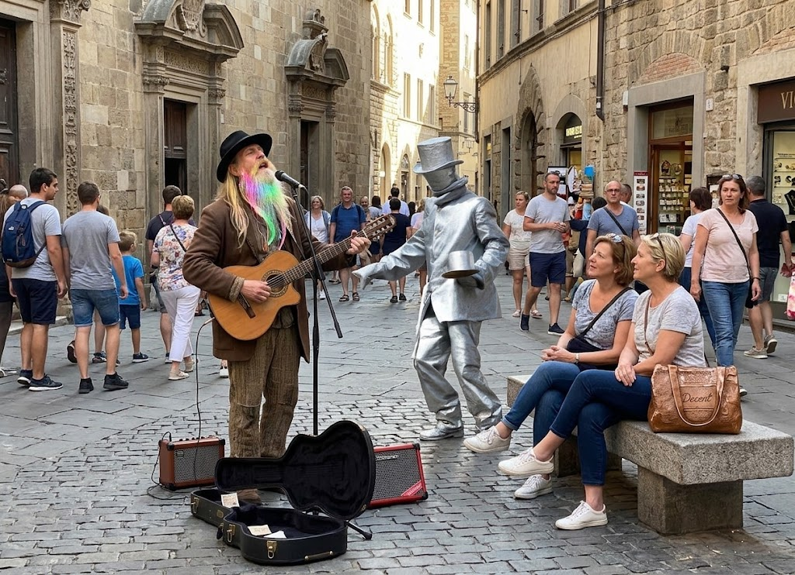

# DecentBusking

**Drop a track. Join the loop. Mint it when you’re ready.**

DecentBusking is a community listening room, a 3D timeline of music NFTs, and a Discord radio built around the people who make the music. Listen, explore the archive, tip a performer, or bring a track into JukeLoop.

Read the [Decent Busking whitepaper](WHITEPAPER.md) for the vision, current architecture, payment mechanics, artist-rights limits, and roadmap. Implemented features are separated from future plans.

<p align="center">
  <a href="https://thejollylama.github.io/DecentBusking/"></a>
</p>

## Come Listen

The **DJuke** drawer uses a chrome/platinum jukebox with an animated quarter,
music notes and a dim LCD equalizer driven by the shared live music spectrum.
DVert uses the same meter behind its prices and animates its tab icons in the
header. Meters rest without playback and stop when hidden or reduced motion is
enabled; no independent media sources or simulated music loops are created.
Its **i** button explains queue pricing, payment splits and worker-gas charges.
Connect through the page header; a disconnected **Queue Song** click shows the
wallet reminder without starting a transaction.

**Top Jukebox Earners** ranks the top three artist/collaborator wallets by
all-time confirmed DJuke song-play payouts, with ENS or decorated wallet links
to Basescan. It reuses the checkpointed earnings index at
`GET /api/djuke/earners`, excluding album purchases, withdrawals, listener spending
and platform payouts. Unavailable/incomplete indexing is reported explicitly,
not shown as zero earnings. Deploy both the worker and site for this feature.
All DJuke decorative animations respect reduced-motion preferences.
The **Top 10** title also has an **i** dialog explaining net votes, weekly prize
estimates and closeout, Friday Hype's opening chart, and playlist saves.
Voting with the radio thumbs-up/down buttons keeps the chart open. Confirmed
votes refresh its counts and rankings immediately; other listeners' votes are
picked up by the existing 15-second refresh while the panel is open.
While a song or advert plays, a dim live meter stays above the first visible
chart row, rising behind the panel's title and subtitle without covering their
controls, even when the playing song is ranked farther down the chart.
The upper-left meter button switches between frequency bars and the actual
time-domain waveform, using the radio's shared analyser. The filled waveform
uses reduced amplitude, averaged samples and rounded curves for a gentler look.
The meter rests without playback and stops for reduced motion.
While a main-radio advert plays, an unranked **Advert · Live Now** row shows its
per-play net votes and uses the same live bar/wave meter. The vote tooltip gives
up/down counts. It disappears on song handoff, has no playlist-save control,
and never participates in music rankings or prize calculations. Counts require
the matching worker update; older workers show unavailable rather than zero.

**First visit?** Follow the [newcomer walkthrough](docs/NEWCOMERS.md) for a click-by-click listener and artist route with screenshots.

The on-site **Follow the white rabbit** launcher appears above the radio until
the visitor finishes every stop. Completion is remembered in that browser;
leaving early does not hide the launcher. The identical rabbit button remains
available in the DBusker About modal for replay. The Mercury symbol follows the white rabbit with
musical accessories and a small flying-money icon, while the rabbit mascot peeks
in and out of holes beside highlighted controls. Factual text explains each stop;
Mercury is a visual companion, not a narrator. This
read-only guided tour opens real drawers and ankh menus; it never triggers wallet,
vote, upload, purchase, or audio actions. Exit restores existing drawers and visible
briefcase drafts. Active submissions, open dialogs, and VertLoop listening defer
the tour with an explanation. Keyboard navigation, focus return, narrow screens,
and reduced-motion preferences are supported.

The subheader's **Search Artist or Song** field searches the indexed music
catalog by artist or title. It shares its query with archive search; typing in
the subheader clears any archive artist selection so a new search covers all
artists. The archive retains its separate artist dropdown and result counts.
The footer shows live net votes beside the thumbs: songs use the current New York
weekly chart total; adverts use votes for the current advert play. Totals refresh
with the radio poll and after a confirmed vote. Unavailable totals show a dash,
not a guessed zero.
The tilted block-style counter celebrates actual increases with floating music
notes and sinks toward a hole on decreases. Initial loads and track changes do
not trigger vote celebrations; reduced-motion preferences disable the effects.
Header menu coins accept clicks across their full coin area and support Enter
and Space. The warm orange-white neon title flickers briefly every 30 seconds;
the end symbols carry a travelling electric pulse. Both remain steady with
reduced motion enabled.

The footer uses a compact advert countdown: “next ad after this song”, “next ad
after next song”, or “next ad after N more songs”, without changing scheduling.
Footer NFT verification matches the exact IPFS media identity even when radio
playback uses a relay or preloaded blob URL. Lookup failures report verification
unavailability rather than implying the song has not been minted.

Open the [DecentBusking town square](https://thejollylama.github.io/DecentBusking/) and explore the 3D music timeline. Select a track in the archive to click **Preview** for a free 30-second taste or **Listen** to play the whole song, inspect its NFT details, and tip the artist. Connect MetaMask on Base when you want to send a tip.

The site radio streams and preloads recordings through the worker's public `GET /api/radio/media?cid=…` endpoint, which only serves recordings known to the radio playlist. The worker uses its dedicated IPFS gateway (or the original Discord upload) without sharing gateway credentials with browsers, and forwards HTTP ranges for seeking. The configured public gateway remains a browser fallback. Deploy both the worker and site when updating this route.

Join [DecentBusking on Discord](https://discord.gg/SCtcBggHPa), head to **#DecentJukebox**, and tune in to the **JukeLoop** voice channel. The radio rotates community uploads; listeners can react 👍 or 👎. The bot tracks cumulative votes and plays, and the ratings influence future rotation.

Open the **Top 10** pull-tab on the upper-left to see this New York week's most-voted songs and their current USDC prize estimates. Each song holds its own prize place, even when one artist has several winning songs. First place receives half the weekly pot, each subsequent place receives half the remaining pot, and the last payable place receives the remainder. Every payable prize must exceed $0.10; a smaller pot supports fewer payable places. Estimates change with votes and confirmed funding, then freeze at Monday midnight in America/New_York. Payments still require owner approval.

Friday's **Top 10 Hype Hour** (8-9 p.m. America/New_York by default) plays a checkpointed opening chart from its lowest place toward opening #1. Votes keep changing the live chart, not that show's play order. The festival sidepanel pops out when the hour starts (it can be minimized while the countdown keeps playing), the radio player shows **Listening to Top 10 Friday Night Hype**, the panel's **i** button explains the program, labels opening and live ranks separately, and offers **+** buttons to save verified songs to your personal playlist (your wallet-backed profile watchlist). During Hype only, the expanded panel can cover the header/footer: desktop places the scrollable chart beside the festival poster, while mobile stacks them with room for at least four to five songs on typical phone screens. Outside Hype, the regular drawer size and header/footer clearance are unchanged. Signing a watchlist save is not a purchase. Early finishes use labelled encores of the same opening selection; the scheduled handoff still takes priority at 9 p.m., even if the countdown is unfinished.

### Cancelling a live slot

Open the community radio schedule with the owner wallet connected and choose **Cancel event** on the dated occurrence. Enter a public reason, confirm, and sign the calendar update. The occurrence remains visible with a red **Canceled** stamp for seven days; future recurring Fridays are unchanged. The shared worker calendar persists the cancellation across restarts, and open calendars refresh every 15 seconds. Cancellation does not approve, refund, or settle performer payments.

Listeners can choose **Set reminder** for the next weekly show or a scheduled
live event. Apple/Outlook `.ics` downloads include a 15-minute display alarm.
Google Calendar opens a prefilled event; select a 15-minute notification before
saving (Google's event-template URL does not set notification preferences).
Save into an account synced across devices; imported individual events do not
receive later schedule updates.

**Sync the community radio calendar** exposes the public
`GET /api/radio/calendar.ics` subscription for Google, Apple and Outlook.
The feed includes weekly shows and live bookings for the next 90 days plus
seven days of recent occurrences. It uses stable occurrence UIDs, UTC timestamps
calculated from New York wall-clock times (including DST), cancellation status
and 15-minute alarms. Calendar clients control refresh frequency and whether
subscription alarms are enabled; updates are not instant. During calendar
restore the endpoint returns 503 rather than an incomplete feed that could
remove subscribers' events. No wallet, notification permission or personal
calendar credentials are needed by DecentBusking.

Cancelled live slots leave automated radio running. After Friday Hype, or when starting in a cancelled live slot, the radio tries an eligible advert before returning to music, subject to existing campaign capacity, availability, and paid-request priority. Never-played campaigns get preference in ordinary main-radio advert selection; paid priority boosts remain ahead of that preference.

**DVert campaigns cost $5 USDC for one week.** Optional priority payments do not buy or extend a campaign. A **queue bump** starts at $1 USDC, doubling every seven pending requests, and moves an active approved advert to the next normal advert break. **Play after this song** costs **2x that queue price** for an extra break. Immediate requests take priority over bumps, FIFO is preserved within each tier, and both defer during protected shows. Payments remain reserved until naturally completed playback; removed unplayed requests have payer-claimed full refunds. The replacement two-tier contract is deployed and source verified, but public checkout stays disabled pending separately approved live acceptance of both tiers. See the [paid advert queue policy and deployment checklist](docs/DVERT-PAID-QUEUE.md).

## Bring A Track

**New here? Start with one song.** Post audio or MP4 in [#DecentJukebox](https://discord.gg/SCtcBggHPa), or click the guitar case on the site. Discord attachments can be up to 10 MB. The site accepts files up to 50 MB, or an existing IPFS file CID for larger media. You do not need a Pinata account.

After a Discord upload is pinned, the bot replies with a **Request NFT** button. Click it to provide your Base artist wallet and optional artwork; submitting the private form automatically adds the request to the owner mint queue. For the site guitar case, connect your artist wallet, enter the track details, and submit. Neither flow mints automatically; the owner reviews and approves requests.

The site's creator briefcase is a three-part flow: drop audio/MP4 video (or paste
a pinned file CID), add title/artist and optional artwork, then review earning
wallets. Local media is detected from its content and previewed without
autoplay; there is no manual format selector or MP3 fallback for unknown files.
Pinned media uses `GET /api/ipfs/media-type?cid=...`, which normalizes the CID
and reads bounded 64 KiB header/tail samples rather than downloading the whole
file. Detection failures are shown explicitly. Artwork accepts an image upload
or a file CID independently of the main media source.

Check **This is a DVert advertisement** for ad submissions. Approval marks the
NFT and recording as an advert, excluded from ordinary music rotation, music
Top 10 and DJuke song registration. Advertisers still book and fund airtime
through DVert separately; this checkbox does not create a paid campaign.

For songs, add up to nine collaborator wallets alongside the artist. Adding or
removing a collaborator defaults the shares to an even split (10000 basis
points, with deterministic rounding); each share can be edited to two decimal
places and the total must be exactly 100%. Duplicate/zero wallets and zero
shares are rejected. These are **DJuke creator-earnings shares only**, not
ownership of a wallet or multiple NFT recipients. The artist still receives
the NFT, ERC-2981 royalties and weekly radio prizes; direct tips still go to
the specified tip wallet. Shares are signed by the submitter, checked server
side, checkpointed with the request, shown during owner approval and included
in minted metadata. DJuke registration and its manifest use the approved
shares; existing registered/requested on-chain splits are never silently
rewritten. A conflicting registration logs an explicit admin-review warning.
Resubmitting the same recording with changed shares or advert classification
requires owner review instead of silently returning the old settings.

Deploy the updated worker before publishing the redesigned briefcase: it needs
the media-detection endpoint and signature support for creator splits.

Artwork is optional. Attach PNG, JPEG, WebP, or GIF up to 10 MB, enter an IPFS image CID for a larger image, or leave it blank to use your Discord profile image. The owner reviews the request and mints approved NFTs directly to the artist wallet.

For Discord NFT requests, including `/jukebox submit` with a media CID, the profile image is queued as the default artwork. Admin shows that image in the preview; leave both replacement fields empty to keep it, choose a new image up to 10 MB, or enter an image/GIF file CID for larger artwork. CID mode references the existing file rather than re-uploading it. A valid CID is not a guarantee of availability; review the image preview before minting. Website-only submissions have no Discord profile association.

## Earn From Radio Plays

Use the same Base wallet for your music NFT and artist payout. A qualifying play is a completed, audible Discord playback of at least 30 seconds. Likes and dislikes influence rotation; they are not paid plays.

Playback rewards are paid only from a funded weekly USDC budget. The owner reviews the completed week's allocation before paying on Base. **Playback Tally counts activity; it does not guarantee a payout.** If no budget is funded or approved, no playback payment is due.

## Help Without Coding

You can help without writing code:

- **Make or share art:** offer original cover art, posters, or video assets. Artists can attach optional cover art to a mint request. For art used across the project, open an issue first and say how we may use it. Only share work you made or have permission to share.
- **Help shape a gallery:** suggest an artist spotlight, a themed listening playlist, or a way to show community artwork in the archive. A broader gallery is an idea to shape, not a separate paid feature today.
- **Test and welcome people:** listen to JukeLoop, vote, test the site on mobile, report a reproducible problem, invite an artist, or host a listening session.

These activities are welcome, but are **not automatically paid**. If you want payment for a specific art, testing, or outreach task, ask the maintainer to agree on the task and bounty before starting. The work must have an eligible GitHub issue and accepted submission to enter repo payroll.

## Build And Earn

1. [Choose an open issue](https://github.com/TheJollyLaMa/DecentBusking/issues) and ask to be assigned. If you are new to the project, start with a small issue and ask questions.
2. Work on it and open a pull request that includes `Closes #issue-number`.
3. Use the bounty amount and token shown on the issue, for example `bounty: 10 USDC` or `bounty: 10 ART`. Do not guess an amount or add a payout label yourself.
4. After the pull request is merged, an issue with an approved bounty label can enter the repo payout queue. The owner reviews and settles eligible rewards from the funded Base treasury.

Contributor payouts are separate from radio playback rewards. See [Contributor Payroll](docs/PAYROLL.md) and the [Contributor Request form](https://github.com/TheJollyLaMa/DecentBusking/issues/new?template=whitelist-request.yml) to add your payout wallet. Participating is free; rewards depend on an approved bounty, an accepted merged contribution, and a funded treasury.

## Owner Mint Queue

The contract owner opens **Admin** from the DecentBusking header menu, connects the `DEFAULT_ADMIN_ROLE` wallet on Base, and signs to load pending community requests. The queue shows the artist, destination wallet, track, and submitted artwork. Owners can mint requests one at a time or select several for batch processing in groups of up to 20.

New owner-approved mints use DecentNFT v0.3 and require one Base confirmation per batch. The owner wallet pays gas; each NFT is minted directly to its approved artist recipient. Existing v0.2 NFTs remain unchanged and continue to appear in the archive. After confirmation, the bot verifies the collection-qualified Base receipt, updates the durable queue, and announces the minted NFTs in Discord. Reviewed album imports are queued for owner review but never minted automatically.

## DecentNFT On Base

Existing DecentBusking music NFTs use the DecentNFT v0.2 ERC-1155 contract on Base Mainnet:

- Contract: [`0xe63EC9f8228720bAAC2fD528C0A6d06B3Dc5439B`](https://basescan.org/address/0xe63EC9f8228720bAAC2fD528C0A6d06B3Dc5439B)
- Network: [Base Mainnet](https://basescan.org/)
- Metadata and audio: IPFS, pinned through the DecentBusking service
- Artwork: optional IPFS image included in the NFT metadata
- Current royalty: 5% ERC-2981 royalty receiver set to the artist wallet

New owner-approved mints use the deployed DecentNFT v0.3 batch-capable collection. The v0.2 collection remains in the archive; v0.3 does not migrate or renumber existing v0.2 NFTs.

Minted music appears in the DecentBusking 3D timeline and archive for listening and selection. Marketplace purchase, resale, and richer multi-artist royalty splits are still being developed; a DecentMarket link does not necessarily mean a track is currently listed for sale.

The archive initially loads the latest 25 music NFTs. Search the full indexed
archive by artist or song title, select an artist to browse their collection,
or use **Load 25 more** and the timeline to explore older mints. There is no
automatic full-collection download. Admin reviews mint requests in pages of 20.
Deploy the worker's `/api/nfts` and paginated mint-queue API before publishing
the updated browser. A worker cold start may show an explicit catalog-restoring
message until its first verified Base scan finishes.

## How It Works

- **JukeLoop:** Discord voice radio plays community tracks and applies vote-weighted rotation.
- **3D archive:** Base music NFTs are placed on a timeline by mint date; select an archive entry to listen and view details.
- **Pinata + IPFS:** Audio, artwork, and metadata use the shared upload service. The bot checkpoints playlist, vote, and mint-queue state to IPFS so the Render free-tier service does not require a persistent disk.
- **Owner controls:** Admin handles the NFT mint queue. Payroll shows repo rewards and weekly radio payout drafts; the owner approves reviewed payouts from funded Base funds. Discord `/jukeloop restart` reconnects the radio; `/jukeloop stats` shows track ratings.

## Build With Us

Everyone is welcome: code, testing, documentation, art, accessibility, and ideas all help make the town square better. Browse [open issues](https://github.com/TheJollyLaMa/DecentBusking/issues), ask to be assigned, and link your pull request with `Closes #N`.

Contributor rewards may be available in ART or USDC from the Base `dbusk-repo-dev` fund. See [Contributor Payroll](docs/PAYROLL.md) and the [Contributor Request form](https://github.com/TheJollyLaMa/DecentBusking/issues/new?template=whitelist-request.yml).

## Run Locally

```sh
npx serve .
```

The static dapp can be explored without a wallet. Connect MetaMask on Base for wallet features. Local IPFS upload can use Kubo/IPFS Desktop; production uploads use the Render service and Pinata.

### Base RPC

Browsers read Base from free public RPCs and only fall back to the worker's read-only `POST /api/rpc` proxy when those are rate-limited. Fund breakdowns and creator earnings come from the worker's indexes (`/api/funds`, `/api/earnings/:address`), not browser log scans. The worker keeps the paid (Alchemy) URLs in Render env vars only, paces them against a monthly compute-unit budget and falls back to public endpoints when that runs low; see `discord-bot/.env.example` and `GET /api/rpc-health`. Never put RPC keys in `decent.config.js`.

Optional push updates: create an Alchemy **Custom Webhook** on Base Mainnet that sends logs from the settlement router, DeVert, DJuke and DecentNFT contracts to `POST /api/webhooks/alchemy`, and set its signing key as `ALCHEMY_WEBHOOK_SIGNING_KEY`. The worker verifies the `X-Alchemy-Signature` HMAC and only uses a delivery as a signal to refresh the matching ledgers from the chain, so payload contents are never trusted. While it is configured, background pollers slow to a 5-minute safety net (`WEBHOOK_SAFETY_POLL_MS`). Delivery stats appear under `webhook` in `GET /api/rpc-health`.

## Links

- [Listen in the DecentBusking town square](https://thejollylama.github.io/DecentBusking/)
- [Join the Discord community](https://discord.gg/SCtcBggHPa)
- [View DecentNFT on BaseScan](https://basescan.org/address/0xe63EC9f8228720bAAC2fD528C0A6d06B3Dc5439B)
- [DecentMarket](https://thejollylama.github.io/DecentMarket/)
- [DecentBusking issues](https://github.com/TheJollyLaMa/DecentBusking/issues)
- [DecentMarket v0.3 contract plans](https://github.com/TheJollyLaMa/DecentMarket/issues/47)
