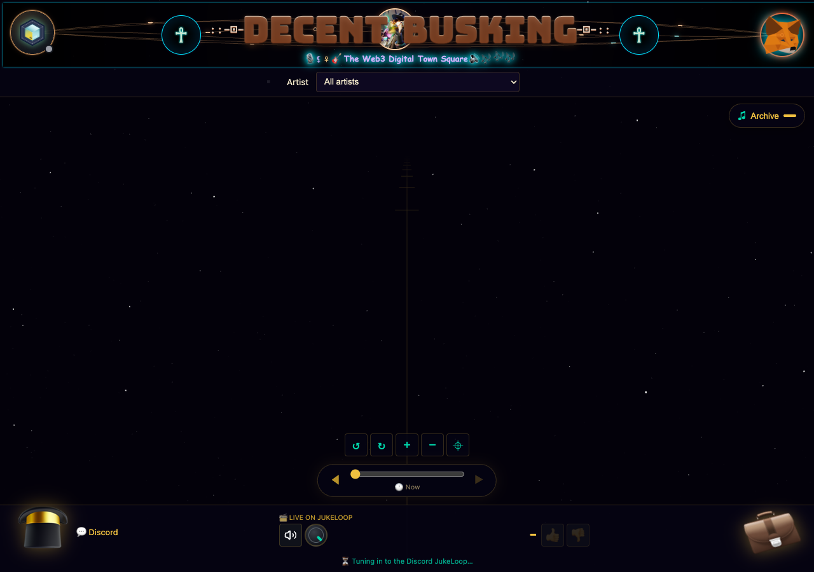
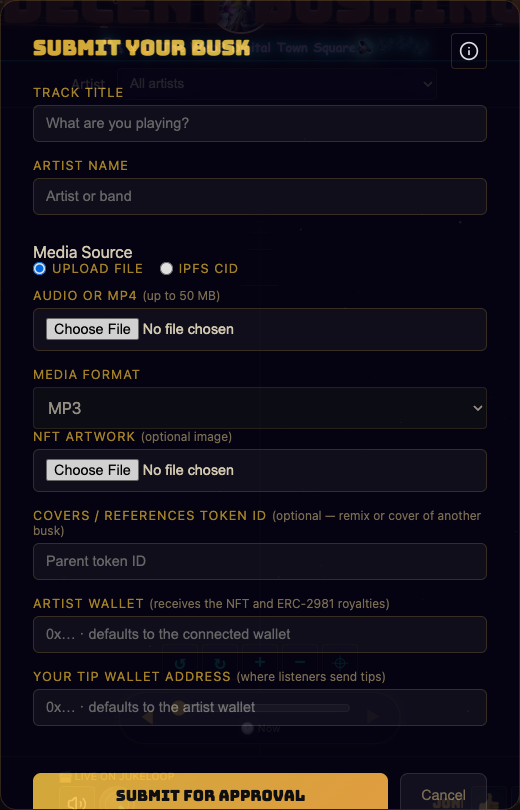
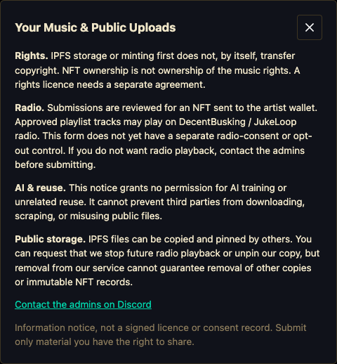

# Your First Visit To DecentBusking

Start here: [open DecentBusking](https://thejollylama.github.io/DecentBusking/). You can listen and explore without connecting a wallet. Take the listener route first; submit a song only when you are ready to share it publicly.

## Follow The White Rabbit

Look for **Follow the white rabbit** in the center of the landing scene. The large
**☿** Mercury symbol follows the rabbit with a small flying-money icon and
different musical accessories at every stop. Mercury is a visual companion,
not a narrator. A white rabbit peeks out of little rabbit holes beside each
stop, with factual text explaining the controls. The tour opens the actual
briefcase, Top 10, DVert, DJuke, archive, and both ankh menus, explaining what each
is for without voting, submitting, connecting a wallet, paying, or starting audio.

Choose **Follow**, **Back**, or **Leave tour** at your own pace. Arrow keys move
between stops when the card has focus; Tab also lets you explore the page. On exit,
previously open drawers and any visible briefcase draft are restored. Finish any
pending submission, close other dialogs, and return from VertLoop to main radio
before starting. Reduced-motion settings keep the rabbit and Mercury still.
The card count sits beside **Follow the White Rabbit**. A centered hole in the
card is the rabbit's home: it dives down, emerges beside the highlighted feature
with a short hop and sparkles, and returns home before the next card appears.
Navigation pauses briefly during the trip; **Leave tour** and **Close tutorial**
remain available. Outside clicks and Escape do not dismiss the tour.
Reduced motion skips the trip and decorative effects.
After completing every stop, the landing-page button is hidden in that browser.
Leaving early does not count as completion. Click **DBusker** to open **About**
and use the identical **Follow the white rabbit** button to replay the tour.
Music notes and little sound-wave rings accompany Mercury's arrivals. These are
visual effects, not extra audio over the radio.

### Build a DJuke playlist with the bunny

[Open the playlist tutorial](https://thejollylama.github.io/DecentBusking/?tutorial=playlists).
This link opens directly to the playlist card even if you have already completed
the general tour. The same card is included after DJuke in the full walkthrough.
Mercury follows the bunny between the real controls:

1. Search for a song or creator and choose a song.
2. Use **Add selected song** to build a draft of up to 24 songs.
3. Name the mix, reorder with **↑ / ↓**, or remove a song with **×**.
4. **Save to Profile** signs and keeps a named revision, without buying playback.
5. **Personal Play** buys your mix at creator prices for your ears only.
6. **Play Live** queues it for the community, at the displayed radio tier prices
   plus $3 per started group of 12 songs. Base network gas is additional.
   Protected hours/shows can set your mix aside; remaining songs return to the
   queue afterward without another payment.
   There is no refund solely for that delay or interruption. Separate
   failed-delivery refunds still apply; exact playback times are not guaranteed.
   If your estimated playlist/current/queued playback overlaps a protected block
   on the public calendar, checkout names the show and asks before proceeding.
   Unknown song lengths use a rough four-minute-per-song allowance; ordinary
   checkout without a detected overlap has no separate confirmation window.
7. See how song payments split 90% to musicians/collaborators, 8% to pinning, and
   2% to development, while the separate radio fee splits 25% each to Playback,
   Top 10, Pinners, and Development. The radio fee settles after full delivery.
8. See a labeled illustration of your playlist taking the radio stage after the
   current song and protected shows. Main paid requests can cut in between songs.

**Follow** and **Back** move through these hops without editing your draft,
signing, paying, or changing the live radio. Empty/unavailable controls stay
disabled. The fee-flow and radio illustrations are explanations, not payment
receipts or a live takeover. Ending this linked guide leaves DJuke open to try;
leaving early restores the original drawer and playlist disclosure state.

## Three Names, One Community

| Name | What you are looking at |
| --- | --- |
| **DecentBusking** | The website: live radio, the music NFT archive, artist tips, submissions, and playback tallies. |
| **#DecentJukebox** | The Discord channel where artists post songs and the bot handles upload and NFT-request replies. |
| **JukeLoop** | The ongoing community radio rotation in Discord voice, synchronized to the website's radio. |

An NFT is a token referring to a song and its metadata. Owning or minting the token does not, by itself, transfer copyright or grant music-use rights.

## 1. Listen First

Look at the **bottom radio bar**. It shows the current song and artist when JukeLoop is playing.

The screenshot shows the first-load view while the archive and radio are loading. Song artwork and the current track will change; a star field alone does not mean you need to connect a wallet.

1. Click **Tune in** if it appears. Browsers can require a click before sound starts.
2. Use the **speaker button** to mute or unmute, and the **volume control** beside it to adjust the radio.
3. If you see a between-tracks or reconnecting message, wait for the next track. Repeated clicks will not manufacture a live stream.

**You have reached this step when:** you can hear the current track and recognize its title and artist. No wallet or payment is required.

## 2. Vote On What Is Playing

Click **thumbs up** or **thumbs down** in the bottom radio bar while a track is active. Disabled voting buttons mean there is no eligible current play yet. The site accepts one vote per browser for that play, not a new vote for every click.

Votes influence the radio rotation. New Top 10 prize drafts use weekly net votes, but prizes need a funded budget and owner review. A vote is not a payment or a guarantee of earnings.

**You have reached this step when:** the vote control acknowledges your choice.

## 3. Meet A Song And Its Artist

Select a music NFT in the **3D music space / archive**. Inspect its song details and artwork. Click **Preview** for a free 30-second taste or **Listen** to play the whole song. Selecting an archive recording is different from listening to the live radio: use **Radio** in the bottom bar to return to JukeLoop.

Click **Archive** near the upper-right of the music space for the song list, or use **Search Artist or Song** below the header. Wait for metadata to load if the archive is initially empty.

The **hat** opens the tip form. A tip is a real wallet payment, not a free interaction. Check the destination, token, amount, network, and wallet fees before confirming. You do not need to send a tip to keep exploring.

The **Left Ankh** at the top opens the public **Playback Tally**. This is the whole station's activity, not just your songs. Admin and Payroll entries are owner tools; ordinary listeners do not need them.

**You have reached this step when:** you can tell the difference between an archive song, the live radio, and the public tally.

## 4. Bring One Song

Choose one route. Do not submit the same song twice just because owner review takes time.

### Website Route

1. Click the **briefcase** to open **Bring your sound**.
2. Click the little **i** beside the heading and read **Your Music & Public Uploads** before choosing a file.
3. Connect your artist wallet using the **wallet control at the top-right**, then return to the briefcase. Artist actions use Base.
4. Enter the **Title** and **Artist / creator**. Drop supported audio or MP4 up to 50 MB, or choose **Already on IPFS** for an already-pinned file. A CID is not a folder path or a gateway URL; media format is detected automatically.
5. Artwork is optional and accepts an image file or IPFS CID independently of the media source. Check the artist wallet: that is where the approved NFT will go. Collaborator percentages apply only to DJuke creator earnings, not joint NFT ownership, royalties, weekly prizes, or tips. The alternate tip wallet is under the extra options. Referencing another token does not grant permission to use someone else's song. Mark DVert submissions as adverts; airtime is booked separately through DVert.
6. Click **Submit for Approval**. Wallet signatures authorize the upload/submission; read each prompt. This is not the owner's mint transaction.
7. Look for **Queued for owner approval** and the IPFS CID. Keep the CID and wait for review rather than repeatedly submitting.

**You have reached this step when:** the form says the song is queued. The artist request does not mint automatically, promise radio scheduling, or guarantee a payout. The owner reviews and pays gas for an approved mint sent to the chosen artist wallet.

The NFT's royalty setting describes a royalty request to compatible marketplaces, not guaranteed income or copyright ownership.

### Discord Route

1. [Join Discord](https://discord.gg/SCtcBggHPa) and open **#DecentJukebox**.
2. Post one supported audio or MP4 attachment, up to 10 MB for this bot's attachment flow.
3. Read the bot reply and click **Request NFT** when offered. Enter your Base artist wallet and optional artwork as prompted.
4. Wait for owner review and the mint confirmation reply. Discord upload/playback and an NFT request are distinct steps; ask the admins before posting if you do not want your song played on radio.

To hear the Discord radio, join the **JukeLoop voice channel**. If an attachment is too large, use the website's upload or existing-file-CID route instead.

## Public Uploads: Know The Limits

IPFS files can be downloaded, copied, and pinned by others. The information notice grants no AI-training permission, but cannot stop third-party scraping or guarantee that all public copies can be removed. The current form has no separate radio-consent or opt-out checkbox. If you do not want radio playback, contact the admins before submitting.

You can request that we stop future playlist playback or unpin our copy; that does not guarantee erasing other people's copies or immutable NFT records. This notice is information, not a signed licence or consent agreement. Share only material you have the right to share.

## 5. Find Your Own Songs And Counts

1. Connect the **same artist wallet used to receive your music NFT**.
2. Click the **Right Ankh** at the top-right of the title.
3. Choose **My Playbacks**. This opens **My Playback Tally**, filtered to the connected artist wallet.
4. Start with **All Time**, then choose a UTC week to inspect qualified weekly plays. Use song, artist, and upload-date filters to narrow the list.

The song rows show **Plays**, **Likes**, and **Dislikes**. Those like/dislike columns are lifetime totals even when you select a week. Playback payroll uses qualified weekly plays; Top 10 prize calculations separately use new weekly net-vote buckets. Weekly buckets start fresh on Monday UTC while lifetime totals remain.

**You have reached this step when:** you can find your own song and distinguish its lifetime activity from the selected week's qualified plays. If the list is empty, check the wallet, the date/search filters, and **All Time** first. Counts are not a withdrawable balance; owner-reviewed payments need a funded budget.

## When Something Does Not Match

If you cannot hear the radio, check **Tune in**, mute, volume, and whether a track is actually live. If an upload is queued, wait for the owner rather than re-uploading. If a song or NFT is missing, keep the CID, artist wallet, and any confirmation transaction link, then [ask the admins on Discord](https://discord.gg/SCtcBggHPa). Never send anyone your seed phrase or private key.

You now know the loop: **artist shares a song -> owner reviews an NFT request -> approved music appears in the archive and may join radio -> listeners hear and vote -> tallies record activity -> funded, reviewed payouts are a separate step.**