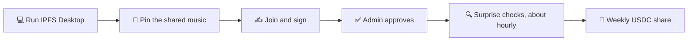

# Earn by pinning: keep the music, share the rewards

[Wiki home](Home.md) · [Technical design](../docs/PINNER-NETWORK.md) · [Open DecentBusking](https://thejollylama.github.io/DecentBusking/)

Every song on DecentBusking lives on IPFS: a public, content-addressed network
where anyone can keep an exact copy of a file. Today most of our copies sit with
one hosting company (Pinata) and one operator computer. **Each new pinner is
another independent home for the music.** If one copy goes dark, the radio
keeps playing from the others. The more pinners we have, the more *decent*
(decentralized) we become.

In return, approved pinners share a weekly fund in Base USDC.



## At a glance

| | |
| --- | --- |
| **What you keep** | About **2.2 GB** today (November 2026): every song in the radio and jukebox catalogue (279), 17 Jones Drive Sessions albums and the public playlist record. It grows as musicians add songs. |
| **What you need** | A computer that stays on most of the day, at least 10 GB free disk space, home internet, and a Base wallet linked to your Discord account in **Profile**. |
| **What you earn** | A share of the weekly `dbusk-pinners` fund. It receives 8% of every song payment and a quarter of each radio fee. Each week, 100% of the fund's unreserved closing balance is split between qualifying pinners, weighted by passed checks. |
| **Who can join** | Musicians and listeners. One Discord member = one wallet = one node. An admin approves every node. |
| **What it costs** | No fees and no gas. Joining is a free signature. You supply electricity, disk space and bandwidth. |

A Pinata account or a single click on **Pin** doesn't earn rewards on its own.
Rewards come from your own node answering our independent checks.

## Choose your path

| Path | Best for | Rewards |
| --- | --- | --- |
| **1. Your everyday computer** | Most people. IPFS Desktop on Mac, Windows or Linux. | Yes |
| **2. An always-on box** | An old laptop, mini PC, Raspberry Pi 4/5 with an SSD, or a home server. The best uptime. | Yes |
| **3. Help without rewards** | Pin a copy to your own Pinata account from the IPFS button. It's a welcome backup, but we can't independently check that it's yours. | No |

## Path 1: step by step

### 1. Install IPFS Desktop

Download it from [docs.ipfs.tech](https://docs.ipfs.tech/install/ipfs-desktop/)
and open it. In its settings, turn on **Launch at login**. If your computer's
firewall asks whether IPFS may accept incoming connections, choose **Allow**.

Turn off automatic sleep while plugged in, or your node can't answer checks:

- **Mac:** System Settings → Energy (or Battery → Options) → *Prevent automatic sleeping when the display is off*.
- **Windows:** Settings → System → Power → Sleep: *Never* when plugged in.

### 2. Let DecentBusking talk to your node

Your browser needs permission to read your node's ID and to pin your private
ownership marker. In IPFS Desktop open **Settings → IPFS Config**, find the
`"API"` section and make it look like this. Keep any other entries you
already have.

```json
"API": {
  "HTTPHeaders": {
    "Access-Control-Allow-Origin": ["https://thejollylama.github.io", "http://127.0.0.1:5001", "https://webui.ipfs.io"],
    "Access-Control-Allow-Methods": ["PUT", "POST", "GET"]
  }
},
```

Save, then restart IPFS from the IPFS Desktop menu. If your browser asks
whether the site may reach devices on your local network, allow it.

> Never add `"*"`, and never open port 5001 to the internet. Port 5001 controls
> your node; only this computer should reach it.

### 3. Check that the internet can reach you

Our checker connects straight to your node from the internet. Most home
routers open the way automatically (UPnP). Give a freshly started node about
10 minutes, then run:

- **Mac/Linux (Terminal):** `curl -s -X POST http://127.0.0.1:5001/api/v0/swarm/addrs/autonat`
- **Windows (PowerShell):** `curl.exe -s -X POST http://127.0.0.1:5001/api/v0/swarm/addrs/autonat`

`"reachability":"Public"` means you're ready. If it says `Private` or `Unknown`:

- In your router's admin page, turn on **UPnP**, or forward port **4001**
  (TCP and UDP) to this computer.
- Mobile hotspots and some internet providers (carrier-grade NAT) can't accept
  incoming connections at all. Use [Path 2](#path-2-an-always-on-box) on a
  rented server instead.

### 4. Pin the shared music

Pick one:

- **Easy:** open [DecentBusking](https://thejollylama.github.io/DecentBusking/),
  press the **IPFS** button on the left of the header, choose **IPFS Desktop**
  and press **Pin shared data**. Keep the tab open. The first run downloads
  about 2.2 GB and can take an hour or more; later runs only fetch what's new.
  Press it again about **once a week** to pick up new songs.
- **Hands-free (recommended):** run the [sync helper](#the-sync-helper). It
  does the same job every 15 minutes with no browser tab.

Pinning never deletes anything. You can stop and resume at any time.

### 5. Join and get approved

1. Connect your Base wallet in the header and link Discord in **Profile**.
2. Open the **IPFS** button → **Join pinner rewards** and sign. It's free, with
   no gas. Your node pins a small, random *ownership marker* that never leaves
   your computer.
3. Tell an admin in the DecentBusking Discord that you've joined. When they
   press **Verify node & approve**, our checker connects directly to your node
   and must find your marker. If approval fails, revisit step 3.

### 6. Stay on and earn

- About once an hour, at unpredictable times, a fresh checker connects only to
  your node. It asks for your marker and random pieces of a random item from
  the shared list. Only your own node can pass. Public gateways and Pinata
  copies don't count.
- The week closes **Monday 00:00 New York time**. To qualify, you need at
  least **20 checks**, at least **90% passed**, and one passed check in the
  final 24 hours.
- **Your share** = your passed checks ÷ everyone's passed checks × the week's
  unreserved pinner fund. Watch your running estimate in the IPFS panel.
  Estimates can change until the week closes.
- After the close, an admin pays the frozen weekly receipt in Base USDC with an
  owner-signed payroll transaction. The panel shows **awaiting payroll** and
  then **paid on Base**.

Twenty checks take about a day of uptime, so join by about Saturday to have a
chance at that week's close.

## The sync helper

The helper keeps your node in step with the shared list. Every 15 minutes it
pins anything new and never removes anything. It needs:

- [Node.js](https://nodejs.org/) 22 or newer.
- A copy of this repository (18 MB). Use `git clone`, or **Code → Download ZIP** on GitHub.

No `npm install`, keys, wallet or secrets are needed.

```sh
git clone --depth 1 https://github.com/TheJollyLaMa/DecentBusking.git
cd DecentBusking
node discord-bot/community-pinner-client.js --watch
```

Brand-new songs may not be announced on the IPFS network yet. For those, the
helper downloads a *verified copy* (a CAR file) from Pinata's public gateway.
IPFS checks every block against its content ID, so a gateway can't slip in
different bytes. Set `PINNER_CAR_GATEWAY` to use another trustless gateway.
Each pinner who holds a song also makes it easier for the next pinner to fetch.

Update occasionally with `git pull`, then restart the helper.

### Start the helper automatically

Replace `/Users/YOU/DecentBusking` with your copy's folder, and the node path
with the output of `which node` (Mac/Linux) or `where node` (Windows).

#### Mac (launchd)

Save as `~/Library/LaunchAgents/com.decentbusking.community-pinner.plist`:

```xml
<?xml version="1.0" encoding="UTF-8"?>
<!DOCTYPE plist PUBLIC "-//Apple//DTD PLIST 1.0//EN" "http://www.apple.com/DTDs/PropertyList-1.0.dtd">
<plist version="1.0"><dict>
  <key>Label</key><string>com.decentbusking.community-pinner</string>
  <key>ProgramArguments</key><array>
    <string>/opt/homebrew/bin/node</string>
    <string>/Users/YOU/DecentBusking/discord-bot/community-pinner-client.js</string>
    <string>--watch</string>
  </array>
  <key>RunAtLoad</key><true/>
  <key>KeepAlive</key><true/>
  <key>ThrottleInterval</key><integer>30</integer>
  <key>StandardOutPath</key><string>/Users/YOU/Library/Logs/community-pinner.log</string>
  <key>StandardErrorPath</key><string>/Users/YOU/Library/Logs/community-pinner.err.log</string>
</dict></plist>
```

```sh
launchctl bootstrap gui/$(id -u) ~/Library/LaunchAgents/com.decentbusking.community-pinner.plist
tail -f ~/Library/Logs/community-pinner.log
```

#### Linux (systemd user service)

Save as `~/.config/systemd/user/community-pinner.service`:

```ini
[Unit]
Description=DecentBusking community pinner
After=network-online.target

[Service]
ExecStart=/usr/bin/node /home/YOU/DecentBusking/discord-bot/community-pinner-client.js --watch
Restart=always
RestartSec=30

[Install]
WantedBy=default.target
```

```sh
systemctl --user enable --now community-pinner
loginctl enable-linger "$USER"   # keep running after you log out
journalctl --user -u community-pinner -f
```

#### Windows (Task Scheduler)

```powershell
schtasks /Create /SC ONLOGON /TN "DecentBusking pinner" /TR "\"C:\Program Files\nodejs\node.exe\" C:\Users\YOU\DecentBusking\discord-bot\community-pinner-client.js --watch"
```

## Path 2: an always-on box

1. Install [Kubo](https://docs.ipfs.tech/install/command-line/) (the IPFS
   command-line node), run `ipfs init`, and start `ipfs daemon` as a service.
   On a Raspberry Pi, keep the IPFS data on an SSD, not the SD card.
2. Allow the site, then restart the daemon:

   ```sh
   ipfs config --json API.HTTPHeaders.Access-Control-Allow-Origin '["https://thejollylama.github.io"]'
   ipfs config --json API.HTTPHeaders.Access-Control-Allow-Methods '["PUT","POST","GET"]'
   ```

3. Check reachability with `ipfs swarm addrs autonat`, as in step 3.
4. Run the [sync helper](#the-sync-helper) on the box.
5. Joining happens in your browser, which must reach the box's port 5001
   privately. Open an SSH tunnel from your laptop, then join while it's open:

   ```sh
   ssh -N -L 5001:127.0.0.1:5001 you@your-box
   ```

## Disk space

- The shared list is about 2.2 GB and grows with each new song (a few MB each)
  and album. Keep at least 10 GB free.
- IPFS Desktop's automatic cleanup removes only *unpinned* cache. Your pinned
  music is never cleaned up.
- If your node also holds other content, raise its storage limit in IPFS Config
  (`Datastore.StorageMax`, default 10 GB).

## Privacy and safety

- You only hold content that is already public: songs, albums and the public
  playlist record. That record includes song credits, uploaders' Discord names
  and IDs, tip wallets, and play and vote tallies. It contains no private keys,
  passwords or message text.
- Like any peer-to-peer app, your node's internet (IP) address is visible to
  other IPFS peers. DecentBusking doesn't publish it. Public receipts show only
  your wallet, node ID, check counts and amounts. If that's a concern, use a
  rented server (Path 2).
- Never share your Pinata key or wallet recovery phrase, and never expose port 5001.
- The ownership marker is random bytes that stay on your node. It proves the node is yours.

## Troubleshooting

| You see | Try |
| --- | --- |
| *Detecting your IPFS Desktop peer…* fails, or *Failed to fetch* | Redo [step 2](#2-let-decentbusking-talk-to-your-node), restart IPFS and allow local-network access in the browser. |
| Approval says your node can't be reached | Redo [step 3](#3-check-that-the-internet-can-reach-you) until it says `Public`. |
| *verified gateway copy failed: gateway returned 403* | That item isn't publicly downloadable yet. A few missing items won't stop you qualifying. |
| *Not yet qualified* | You need 20 checks. Keep the computer awake and IPFS running. |
| You reinstalled IPFS or lost the marker | IPFS panel → **Reset lost node marker**, then ask for approval again. Earlier awards are kept. |
| You want to switch wallets | Ask an admin to suspend the old node first. Awards already frozen stay with the old wallet. |

## Questions

Ask DBusker or an admin in the [DecentBusking Discord](https://discord.gg/SCtcBggHPa). The
[technical design](../docs/PINNER-NETWORK.md) explains how the checks,
receipts and payouts work in detail.
